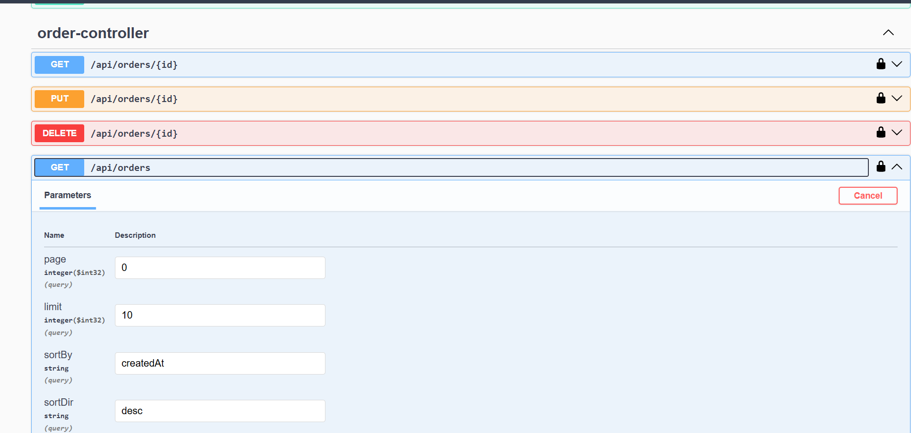
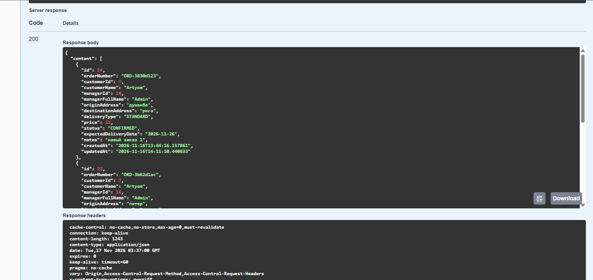
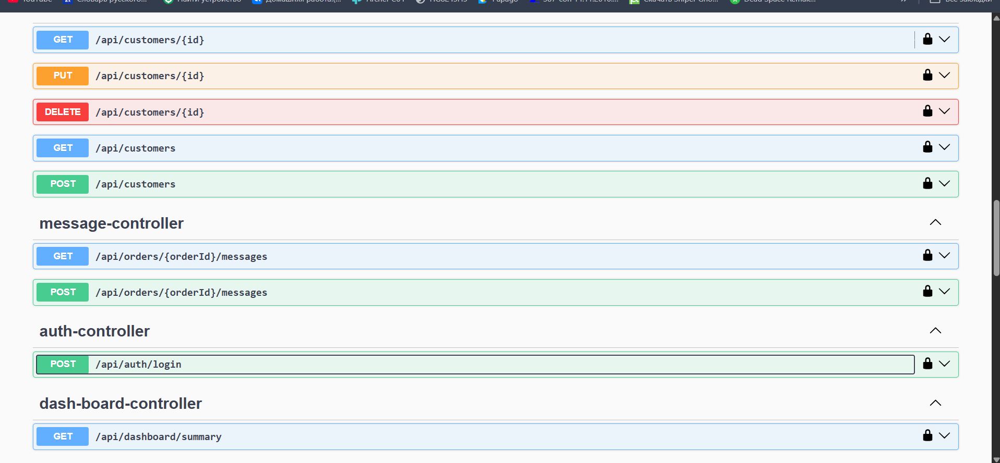
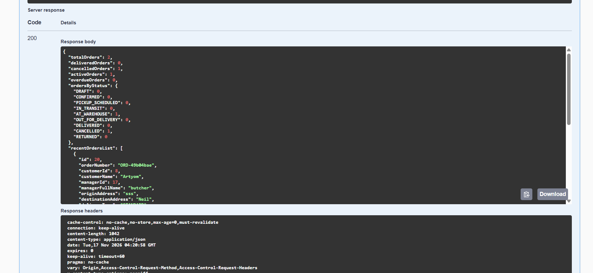
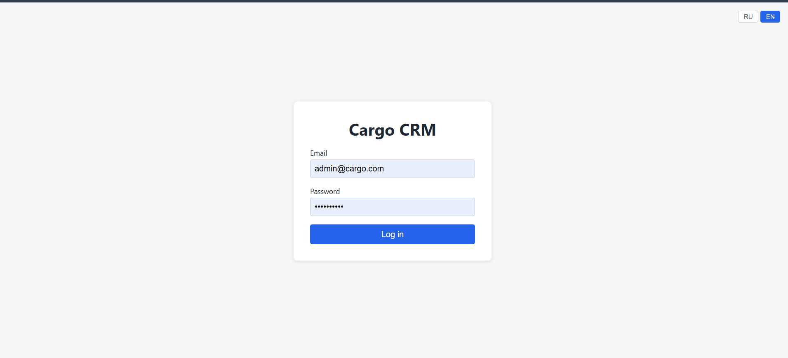

# Cargo CRM

Cargo CRM is a web application for a logistics company. It manages customers, orders and parcels, enforces status workflows with change history, supports per-order messaging and a dashboard summary. Two roles (admin and manager) with different permissions, bilingual interface (Russian and English). Backend: Java 25, Spring Boot, PostgreSQL, Flyway, Spring Security with JWT, Swagger docs. Frontend: React.

## Tech Stack

- Java 25, Spring Boot 4 (Spring Web, Spring Data JPA, Spring Security, Validation)
- PostgreSQL, migrations Flyway
- JWT-authentication, Passwords are hashed with BCrypt
- Swagger / OpenAPI (springdoc)
- Maven

## Features

- **Customers, orders, parcels**: creating, viewing, updating, deleting
- **Search, filters, sorting, pagination** in lists (customers, orders)
- **Advanced statuses**: allowed transition rules and change history
- **Messages** within an order
- **Dashboard**: orders by status, active, delivered, cancelled, overdue, last orders
- **Roles**: ADMIN и MANAGER with different permissions
- **Unified error format** and data validation

## Start

### Requirements

- JDK 25
- PostgreSQL
- Maven (or the bundled `mvnw`)

### Steps

1. Clone repository: `git clone <https://github.com/tanos27038210/Cargo_backEnd>`
2. Create an empty database:
   ```sql
   CREATE DATABASE cargo_crm;
   ```
3. Set the environment variables:

| Variable | Description |
|----------|-------------|
| `DB_USERNAME` | PostgreSQL user |
| `DB_PASSWORD` | PostgreSQL password |
| `JWT_SECRET` | Secret key for token signing (at least 32 characters) |
4. Start application:
   ```
   ./mvnw spring-boot:run
   ```
   (on Windows: `mvnw.cmd spring-boot:run`)

Tables are created automatically on first startup (via Flyway); test users are also seeded in the `dev` profile.

Application: http://localhost:8081

Documentation API (Swagger): http://localhost:8081/swagger-ui/index.html

Frontend URL: https://cargo-frontend-delta.vercel.app

Swagger URL: https://cargo-backendy.onrender.com/swagger-ui/index.html

## Test credentials

| Role          | Email | Password       |
|---------------|---|----------------|
| Administrator | `admin@cargo.com` | `Admin12345`   |
| Manager       | `manager@cargo.com` | `Manager12345` |

## How to use API

1. Send a `POST /api/auth/login` request with an email and password, and extract the `token` from the response.
2. Click  **Authorize** in Swagger and past the token (without the `Bearer` prefix).
3. All subsequent requests will be sent with the token.

## Roles и permissions

| Action                                 | ADMIN | MANAGER         |
|----------------------------------------|-------|-----------------|
| User management                        | yes   | no              |
| View clients, orders and parcels       | yes   | yes             |
| Create and edit customers              | yes    | yes             |
| Create orders and parcels              | yes    | yes             |
| Update orders, parcels, messages       | любых | own only orders |
| Delete customers, orders, parcels      | yes    | no              |
| Cancel an order in status `IN_TRANSIT` | yes    | no              |
| Transitioning a parcel out of status `LOST` | yes    | no              |

## Statuses

Orders: `DRAFT` → `CONFIRMED` → `PICKUP_SCHEDULED` → `IN_TRANSIT` → `AT_WAREHOUSE` /
`OUT_FOR_DELIVERY` → `DELIVERED`. Also `CANCELLED` и `RETURNED`.
`DELIVERED` and `CANCELLED` final. An invalid status transition returns a 400 error.

Parcels: `REGISTERED` → `PICKED_UP` → `IN_TRANSIT` → `SORTING_CENTER` →
`OUT_FOR_DELIVERY` → `DELIVERED`. Also `DAMAGED`, `LOST`, `RETURNED`.

Every status change is recorded in the history (who, when, from, to).

## Basic endpoints

| Method                       | Address                     | Description                                   |
|------------------------------|-----------------------------|-----------------------------------------------|
| POST                         | `/api/auth/login`           | Enter                                         |
| GET, POST, PUT, DELETE       | `/api/customers`            | customers                                     |
| GET, POST, PUT, DELETE       | `/api/orders`               | orders (search, filters, sorting, pagination) |
| PATCH                        | `/api/orders/{id}/status`   | change order status                           |
| GET                          | `/api/orders/{id}/history`  | order status history                          |
| GET, POST                    | `/api/orders/{id}/parcels`  | order`s parsels                               |
| PUT, DELETE                  | `/api/parcels/{id}`         | parcel                                        |
| PATCH                        | `/api/parcels/{id}/status`  | change parcel status                          |
| GET, POST                    | `/api/orders/{id}/messages` | order`s message                               |
| GET                          | `/api/dashboard/summary`    | dashboard                                     |
| GET, POST, PUT, PATCH, PATCH | `/api/users`                | users (ADMIN only)                            |

## Screenshots







## Author

[Artyom Kim] <https://github.com/tanos27038210>