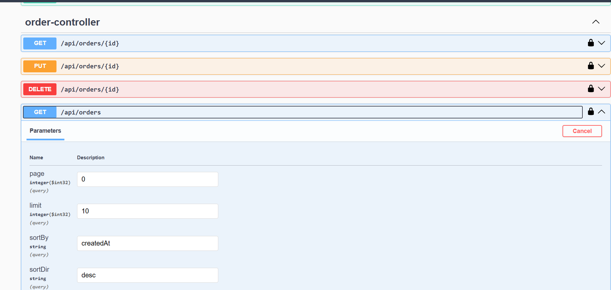
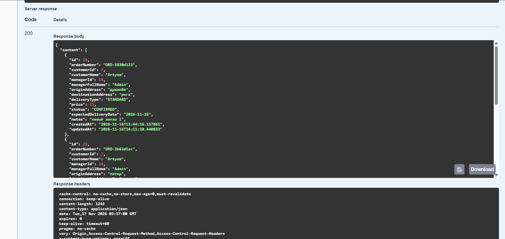
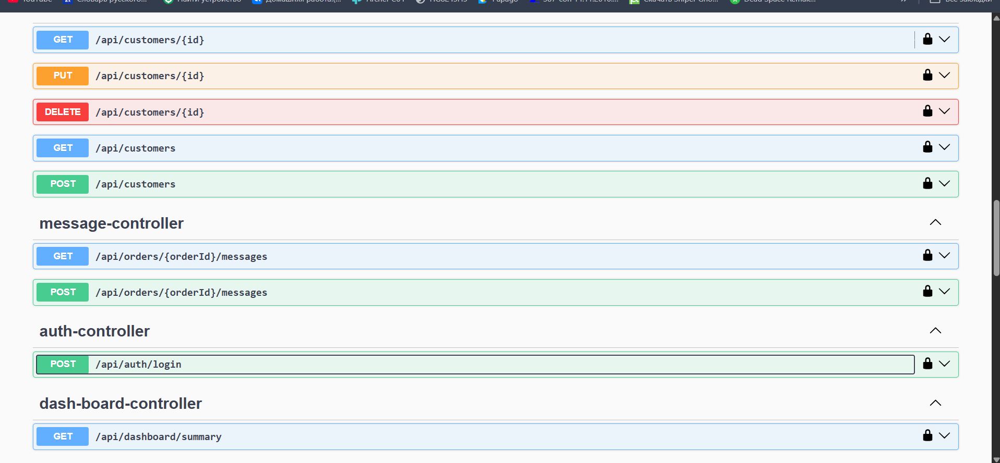
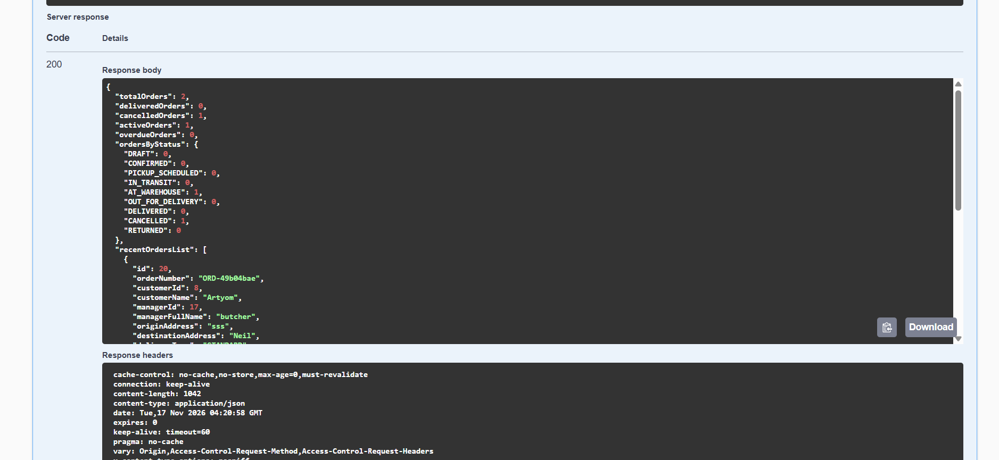
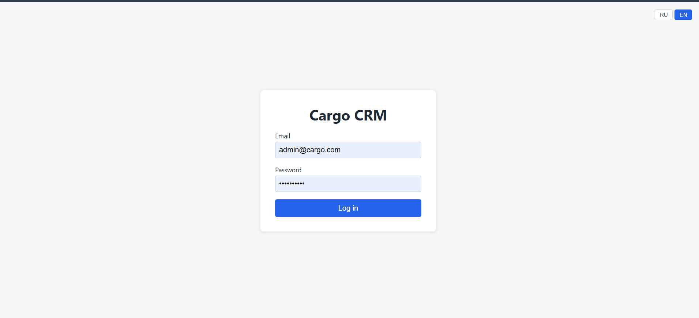

# Cargo CRM

CRM-система для логистической компании: учёт клиентов, заказов на перевозку и посылок,
отслеживание статусов, внутренняя переписка по заказам и сводка по работе компании.
Основные пользователи: сотрудники компании (администраторы и менеджеры).

## Технологии

- Java 25, Spring Boot 4 (Spring Web, Spring Data JPA, Spring Security, Validation)
- PostgreSQL, миграции Flyway
- JWT-аутентификация, пароли хешируются BCrypt
- Swagger / OpenAPI (springdoc)
- Maven

## Возможности

- **Клиенты, заказы, посылки**: создание, просмотр, изменение, удаление
- **Поиск, фильтры, сортировка, пагинация** в списках (клиенты, заказы)
- **Расширенные статусы**: правила допустимых переходов и история изменений
- **Сообщения** внутри заказа
- **Dashboard**: заказы по статусам, активные, доставленные, отменённые, просроченные, последние заказы
- **Роли**: ADMIN и MANAGER с разными правами
- **Единый формат ошибок** и валидация данных

## Запуск

### Требования

- JDK 25
- PostgreSQL
- Maven (или встроенный `mvnw`)

### Шаги

1. Склонируйте репозиторий: `git clone <https://github.com/tanos27038210/Cargo_backEnd>`
2. Создайте пустую базу данных:
   ```sql
   CREATE DATABASE cargo_crm;
   ```
3. Задайте переменные окружения:

   | Переменная | Описание |
      |---|---|
   | `DB_USERNAME` | пользователь PostgreSQL |
   | `DB_PASSWORD` | пароль PostgreSQL |
   | `JWT_SECRET` | секрет для подписи токенов, не короче 32 символов |

4. Запустите приложение:
   ```
   ./mvnw spring-boot:run
   ```
   (на Windows: `mvnw.cmd spring-boot:run`)

Таблицы создаются автоматически при первом запуске (Flyway), в профиле `dev`
также создаются тестовые пользователи.

Приложение: http://localhost:8081

Документация API (Swagger): http://localhost:8081/swagger-ui/index.html

Frontend URL: https://cargo-frontend-delta.vercel.app

Swagger URL: https://cargo-backendy.onrender.com/swagger-ui/index.html

## Тестовые учётные данные

| Роль | Email | Пароль |
|---|---|---|
| Администратор | `admin@cargo.com` | `Admin12345` |
| Менеджер | `manager@cargo.com` | `Manager12345` |

## Как пользоваться API

1. Выполните `POST /api/auth/login` с email и паролем, из ответа возьмите `token`.
2. В Swagger нажмите **Authorize** и вставьте токен (без слова `Bearer`).
3. Все остальные запросы будут отправляться с токеном.

## Роли и права

| Действие | ADMIN | MANAGER |
|---|---|---|
| Управление пользователями | да | нет |
| Просмотр клиентов, заказов, посылок | да | да |
| Создание и изменение клиентов | да | да |
| Создание заказов и посылок | да | да |
| Изменение заказа, посылок, сообщений | любых | только своих заказов |
| Удаление клиентов, заказов, посылок | да | нет |
| Отмена заказа в статусе `IN_TRANSIT` | да | нет |
| Вывод посылки из статуса `LOST` | да | нет |

## Статусы

Заказ: `DRAFT` → `CONFIRMED` → `PICKUP_SCHEDULED` → `IN_TRANSIT` → `AT_WAREHOUSE` /
`OUT_FOR_DELIVERY` → `DELIVERED`. Также `CANCELLED` и `RETURNED`.
`DELIVERED` и `CANCELLED` конечные. Недопустимый переход возвращает ошибку 400.

Посылка: `REGISTERED` → `PICKED_UP` → `IN_TRANSIT` → `SORTING_CENTER` →
`OUT_FOR_DELIVERY` → `DELIVERED`. Также `DAMAGED`, `LOST`, `RETURNED`.

Каждое изменение статуса записывается в историю (кто, когда, откуда, куда).

## Основные endpoints

| Метод                        | Адрес | Описание |
|------------------------------|---|---|
| POST                         | `/api/auth/login` | вход |
| GET, POST, PUT, DELETE       | `/api/customers` | клиенты |
| GET, POST, PUT, DELETE       | `/api/orders` | заказы (поиск, фильтры, сортировка, пагинация) |
| PATCH                        | `/api/orders/{id}/status` | смена статуса заказа |
| GET                          | `/api/orders/{id}/history` | история статусов заказа |
| GET, POST                    | `/api/orders/{id}/parcels` | посылки заказа |
| PUT, DELETE                  | `/api/parcels/{id}` | посылка |
| PATCH                        | `/api/parcels/{id}/status` | смена статуса посылки |
| GET, POST                    | `/api/orders/{id}/messages` | сообщения заказа |
| GET                          | `/api/dashboard/summary` | сводка |
| GET, POST, PUT, PATCH, PATCH | `/api/users` | пользователи (только ADMIN) |

Полное описание в Swagger.

## Скриншоты







## Автор

<Артём Ким>, <https://github.com/tanos27038210>